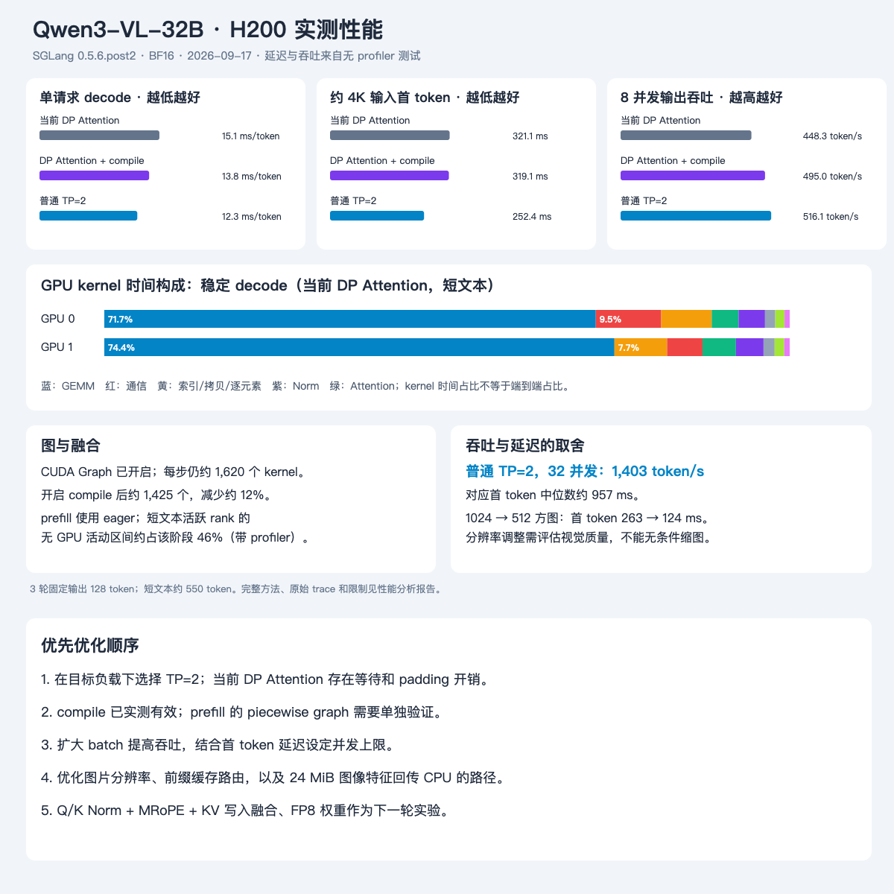

# Qwen3-VL-32B 推理性能分析

2026-09-17 · 实际远程采集 · PyTorch Profiler + 无 profiler 对照测试

**在本次短文本、约 4K 文本和单图负载下，首先应重新评估 DP Attention：普通 TP=2 的 decode 延迟低约 18%，8 并发输出吞吐高约 15%。保留 DP Attention 时，torch.compile 已测得约 9% 的 decode 延迟改善和约 10% 的吞吐改善。** 图文首 token 还受图片大小、前处理搬运和进程间流水线影响，不能只优化 LLM kernel。



## 测量对象与方法

当前实际框架是 **SGLang 0.5.6.post2**，不是 vLLM。PyTorch 2.9.1+cu128，Transformers 4.57.1，BF16，H200 ×2，卡间 NVLink。线上 TP=2、DP=2、DP Attention 开启、32K 上下文、全局并发上限 8、CUDA Graph bucket 1/2/4/8、FA3、Radix Cache 和 overlap scheduler 开启；模型级 torch.compile 与 piecewise graph 关闭。模型是稠密 Qwen3-VL：64 层 LLM、27 层 ViT，非 MoE、非 GDN。

线上只接受测试请求和 profiler 开关操作。TP2、TP1、compile 对照均用其他空闲 GPU 的临时实例，权重和 DP 修复代码相同。所有对照实例已经停止；线上配置与两个修复文件的 SHA256 与测试前一致，最后 19 条混合图文校验通过。

- 无 profiler：每个场景预热，3 轮测试；输出固定 128 token，temperature=0，ignore_eos=true。单请求场景每项 n=3；8 并发场景每项 n=24。短文本约 550 token，长文本约 4,050 token，1024×1024 单图约 1,075 token。nonce 放在提示词开头以避开长前缀命中，仍有少量聊天模板公共 token。
- 输入内容和大小可复现，但每次 nonce 不同，token 数有少量变化，并非逐 token 完全相同。图像是合成几何图，不能替代真实文档、OCR、视频负载。
- 延迟以服务器本机 HTTP 流式客户端测量，不含用户到服务器的公网网络。TTFT 是首个非空文本 chunk 时间；TPOT = 首尾非空 chunk 间隔 / 127。极少 token 不产生可见字符，因此这是客户端可见 TPOT 估计，不是调度器逐 token 硬件计时。
- 输出吞吐 = 各轮输出 token 总数 / 各轮 batch 完成时间总和，包含 prefill、排队和流式响应；不是纯 decode 峰值。
- torch.profiler 实际采集 CPU + CUDA，record_shapes=true、with_stack=false，每个 GPU 场景输出 32 token。按 cudaGraphLaunch 的 correlation 归属 decode kernel，剔除前 5、后 2 个 graph replay 后统计稳定阶段。另在临时前处理进程中采集 CPU 与 CUDA。
- “空泡”定义为分析窗口内 CUDA kernel/memcpy/memset 时间区间并集之外的比例，不含客户端两次请求之间的空闲。它不是 SM 利用率；NCCL 等待即使占据 GPU kernel 时间，也不代表有效计算。
- 最终主表用所有编译预热完成后的 DP Attention、TP2 复测。单卡结果保留为补充参考。GPU 时钟未锁定、未做 NUMA 亲和隔离，3 轮不支持 P99 或细微百分比的统计结论。不同 GPU 对、框架自动参数的差异也存在，结果是部署配置对照，不是严格单算子控制实验。

环境与配置：[environment.json](environment.json)。逐请求数据和汇总：[analysis/benchmark-summary.json](analysis/benchmark-summary.json)。

## 1. 无 profiler 的性能结果

以下延迟均为中位数，单位 ms；decode 为 ms/token。所有配置均使用 CUDA Graph。

| 配置 | 短文本 TTFT | 短文本 decode | 约 4K 文本 TTFT | 1024 方图 TTFT | 8 并发输出 token/s |
|---|---:|---:|---:|---:|---:|
| 当前：TP2 / DP2 Attention | 73.7 | 15.07 | 321.1 | 266.4 | 448.3 |
| DP Attention + torch.compile | 67.2 | 13.78 | 319.1 | 350.9 | 495.0 |
| 普通 TP2 / DP1 | 54.2 | 12.29 | 252.4 | 285.7 | 516.1 |
| 单卡 TP1 | 83.9 | 19.86 | 452.3 | 279.0 | 326.3 |
| 单卡 TP1 + torch.compile | 82.0 | 18.12 | 466.4 | 276.9 | 349.1 |

主表 TP2 复测时并发容量/CUDA Graph 上限已经扩大到 32，但测量实际并发仍是 8；bucket 8 仍覆盖该负载。初次 TP2 上限为 8 时也测到 12.34 ms/token、527.9 token/s，方向一致。TP2 的 chunked_prefill_size 自动为 8192，DP Attention 自动为 4096；所以吞吐差异不能全部归因于一项通信开关。

**吞吐优先实验：** 普通 TP2，max-running-requests=32，cuda-graph-max-bs=32，实际 32 并发，测到 **1,403.5 token/s**；TTFT 中位数 **956.8 ms**，TPOT 中位数 **15.34 ms/token**。相对同一实例 8 并发的 516.1 token/s 提高约 2.72 倍，但 TTFT 从约 270 ms 升至约 957 ms。应按首 token SLO 选 batch 上限，不能把这个吞吐当作无代价收益。

## 2. 算子性能：当前 decode 主要花在哪里

短文本单请求、当前 DP Attention，稳定 decode 的 kernel 时间和：

| kernel 类别 | GPU 0 | GPU 1 | 含义 |
|---|---:|---:|---|
| GEMM / split-K reduction | 71.7% | 74.4% | QKV/O、FFN、LM head 的矩阵计算 |
| 通信 | 9.5% | 5.2% | AllGather、custom all-reduce，包含等待 |
| 索引、拷贝、逐元素 | 7.4% | 7.7% | KV 写入、张量布局、DP buffer、残差等的合并类别 |
| Norm | 3.9% | 4.0% | Q/K RMSNorm、残差 RMSNorm |
| FlashAttention | 3.9% | 4.9% | 主 attention 与合并 kernel |
| 其余 | 3.6% | 3.8% | MRoPE、激活、元数据等 |

代表性热点：`nvjet_tst_256x8_64x6_4x1_v_bz_TNT`，每卡每层约一次、平均约 68 μs；两类其他 GEMM kernel 平均约 28–30 μs。短文本 active rank 的 prefill shape 确认包括 `[542,5120] × [5120,25600]` 的分片 gate/up、`[542,12800] × [12800,5120]` 的 down，以及未做 attention TP 分片的 QKV/O。

小 batch decode 每步要读取大量 BF16 权重，而 FFN 是主要参数来源。**这支持“带宽与小矩阵效率是优先方向”的判断，但本次没有采集 HBM/SM 硬件计数器，不能把 GEMM 时间占比直接当作已证实的显存带宽利用率。** 下一轮应以 Nsight Compute 对少量热点采样，区分 DRAM/L2 带宽、occupancy、Tensor Core 吞吐；不要对整个服务逐 kernel 做重放采样。

短上下文时 attention 只有约 4%–5%，优先重写 FA3 的收益上限不高。32K 上下文和长视频会改变占比，本次没有对它们做性能 profile。

完整 kernel 名称、次数、均值、总时间：[analysis/kernels.csv](analysis/kernels.csv)；分 rank / 分阶段统计：[analysis/trace-summary.json](analysis/trace-summary.json)。分类按 kernel 名称进行，compile 生成的融合 kernel 单列为 compiler_fused，不把其全部时间误算成单一 GEMM 或 Norm。

## 3. DP Attention、负载不均与空泡

当前 DP Attention 把 attention 留在各 DP rank，本模型的稠密 FFN 仍跨卡 TP。每层要在这两个布局间交换数据。decode 每卡每步观测到约 **130 个通信 kernel**，其中约 65 个 NCCL AllGather；64 层的这种小通信频率会积累固定开销。

短文本 prefill trace 中，该次请求落在 GPU 1：

- GPU 1 的 prefill/setup 窗口约 78.1 ms，GPU 无活动区间约 **46.4%**；GEMM kernel 时间和约 28.0 ms。
- GPU 0 没有这条请求的实际 attention prefill，但仍参与 FFN；窗口约 73.8 ms，通信 kernel 时间和 **47.4 ms**。这是同步等待的证据，不能据此说实际传输占满了 NVLink。
- 稳定 decode 两卡无 GPU 活动比例约 **6.5% / 10.0%**。8 并发时约 **11.0% / 10.5%**。这些数值带 profiler 开销；例如 profiler 下 8 并发 TTFT 明显高于无 profiler，因此不将其当作线上空泡精确比例。

CUDA Graph 采用各 DP rank 中的最大 batch，并对每个 rank 使用同形状捕获；只有一路请求时，另一张卡仍回放 attention kernel。trace 中两卡均有每层 attention 调用，源码也显示 global DP buffer 按 `num_tokens × dp_size` 分配。**这里确实存在 idle rank 与 padding 的冗余工作，但不能简单乘以“空闲卡占比”推算可省时间：FFN 分片仍需要两张卡。**

优先方案是已测过的普通 TP2。若业务必须保留 DP Attention，应按 token/视觉工作量改善调度、做缓存亲和路由，并评估 idle rank graph / padding 专项优化。独立单卡副本也值得在目标并发下测，但本次没有直接测“双单卡副本共同服务”，不能将单卡结果乘 2 当作实测吞吐。

## 4. compile、图捕获与图融合

**已经生效的东西：** 当前 decode 已在 CUDA Graph 中运行；prefill 和视觉编码仍可见逐算子 CPU dispatch。图捕获把一串工作统一提交，并不自动把这串 kernel 融成一个。

**compile 的实测结果：**

- 当前 DP Attention：15.07 → 13.78 ms/token，降低约 **8.6%**；8 并发 448.3 → 495.0 token/s，增加约 **10.4%**。
- 单请求每步 kernel 数约 1620/1618 → 1425/1424，减少约 **12%**；8 并发约 1748/1746 → 1233/1232，减少约 **29%**。
- 出现 `triton_red_fused_mm_mul_silu_slice_t_*`、`triton_red_fused__to_copy_add_mean_mm_mul_pow_rsqrt_t_*` 等融合计算 kernel。名称和数量变化证明计算图已改变，但生成 kernel 名称可能包含 FX 来源信息，不能仅凭名称断言所有标记操作都在一个 kernel 中完成。
- DP compile 的捕获/编译阶段约 **159.5 秒**；单卡 compile 约 **110.6 秒**。这个成本属于启动预热，不是请求 latency。应持久化 Inductor/Triton cache，并预热目标 batch bucket。
- 约 4K 文本 TTFT 基本未变（321.1 → 319.1 ms）；图文 TTFT 未见稳定改善。源码显示此开关在 CUDA graph capture 路径编译 model.forward，不能把 decode 的收益套到动态 prefill 或 ViT。

**待验证：** 对 prefill/视觉编码按 token 数和图像 grid 分桶，尝试 piecewise graph 或分段 compile，以减少 Python dispatch、同步和重复 shape 处理。不过当前 0.5.6.post2 的 `can_run_piecewise_cuda_graph()` 在 enable_torch_compile=true 时会明确禁用 piecewise graph；不能把两个开关同时打开便认为收益叠加。普通 TP2 + compile 组合本次未测，也不将两项收益相乘预测。

## 5. 算子融合具体优先级

| 方向 | 已有证据 | 建议与边界 |
|---|---|---|
| Q/K RMSNorm + MRoPE + KV 写入 | 当前 Q/K norm 分开，MRoPE 单独 kernel，另有 index_put 类写入 | 优先做 MRoPE 兼容的专用融合，减少读写和 launch；需覆盖三轴位置、图文混合、KV cache 与 DP padding 正确性 |
| 残差加法 + RMSNorm | 已有 FlashInfer FusedAddRMSNorm | 已有融合应保留；先检查残余未覆盖 shape，避免重复造轮子 |
| gate/up 与 SwiGLU | gate/up 已 packed projection，act_and_mul 已融合；compile 进一步减少 kernel | 继续评估激活/乘法与 GEMM epilogue，但需实测，不能据当前融合 kernel 名称估计独立收益 |
| AllReduce + 下一层残差/Norm | 普通 TP 的 LayerCommunicator 有相应开关路径 | `--enable-flashinfer-allreduce-fusion` 可作为 TP2 候选；源码明确排除 DP Attention。尚未做 A/B，不能保证开启就更快 |
| ViT 布局转换与 Norm/GELU | 图像 trace 有较多布局/逐元素 kernel | 按图像 grid bucketing；融合 transpose/reshape materialization 和相邻逐元素算子，需保留 DeepStack 的中间输出 |

当前 Qwen3 的 CUDA `forward_prepare_native()` 明确先 `_apply_qk_norm()` 再 `rotary_emb()`；本版本该路径没有读取通用 `enable_fused_qk_norm_rope` 开关。**不能仅加此参数就声称 Qwen3-VL 的 MRoPE 已融合。** 源码支持检查见 [source-evidence.txt](source-evidence.txt)。

## 6. 图文 pipeline 与冗余搬运

实际顺序包括：HTTP 解包 → 图像解码/processor/tokenize/MRoPE 位置 → 特征跨进程交付 → ViT/DeepStack → LLM prefill → decode/流式返回。此部署 pp_size=1，不存在多 stage pipeline parallel；这里的 pipeline 优化指这些处理阶段之间的流水线。

在独立临时实例，对同一 processor 路径额外插桩：1024 方图暖态前处理函数耗时约 **13–29 ms**；冷态一次约 **227 ms**。CPU-only profiler 显示 aten::copy_ 是主要 PyTorch CPU 算子之一；它和 aten::to/_to_copy 有嵌套，不能把三者时间相加。

补采 CPU+CUDA trace 确认：

1. 输入 RGB 以 **3 MiB pageable H→D** 拷到 GPU。
2. fast image processor 在 GPU 上执行类型转换、normalize、布局操作等。
3. 展开为 patch 特征后存在 **24 MiB（25,165,824 bytes）D→H pageable** 拷贝；本次带 profiler 约 13 ms，不将其当作无 profiler 的精确成本。
4. 当前 `keep_mm_feature_on_device=false`，源码明确 `.to("cpu")`，后续视觉模型还需将特征搬到其 GPU。

这条回传路径是明确的优化对象。应 A/B `keep_mm_feature_on_device` / CUDA IPC transport，或使用 pinned buffer + async copy，并验证 producer/consumer 生命周期、设备映射及 DP rank 路由。尤其 tokenizer 使用的 GPU 与处理图片的 rank 可能不同，不能直接绕过复制就假定正确。先测端到端收益及显存，再决定采用。

当前 DP 单图 scheduler trace 中，首次 GPU 活动到首个 LLM GEMM 约 **40.7 ms**，覆盖视觉编码、布局、数据准备；prefill/setup 总窗口约 126.4 ms。图文 TTFT 常在 260–300 ms，说明 scheduler GPU 窗口之外仍有前端、IPC、排队等成本。**本次没有跨所有进程建立统一 request span，因此无法把剩余时间精确分摊到 IPC 或队列，也不能全部归因于 CPU 预处理。** 下一轮补齐 HTTP 入站、processor 完成、scheduler 收件、ViT 结束和首 token 出站的统一 request-id 时间戳。

建议把独立请求的图像解码/处理与前一个请求 decode 重叠；按图像大小限制前处理并发，避免大图阻塞普通文本。Vision encoder 拆成独立服务/独立 GPU 属于更大改造，当前吞吐规模没有证据证明值得。Prefill/decode 分离也需要额外 KV 传输和路由开销，本次不建议直接上。

## 7. 图片大小、缓存与其他冗余计算

无 profiler，当前线上 DP Attention；每种图片大小 5 个新请求，固定输出 32 token：

| 方图大小 | 总输入 token（含文本） | TTFT 中位数 |
|---|---:|---:|
| 512×512 | 302–306 | 123.7 ms |
| 1024×1024 | 1070–1073 | 262.8 ms |
| 1536×1536 | 2351–2354 | 775.7 ms |

1024 → 512 在这组图上降低 TTFT 约 53%。更大图增加 patch/视觉 token 和 LLM prefill 工作量。应按业务使用动态分辨率、ROI 或裁剪；OCR 小字和精细定位必须做质量回归，合成几何图不证明低分辨率适用于生产图片。

重复完全相同的约 4K 文本时，前两次分别预热两个 round-robin rank，TTFT 约 324.5/319.6 ms；后四次约 68.5–70.3 ms。日志确认 cached-token=4051、new-token=1。当前是 **rank 本地 Radix Cache + round-robin**，因此可评估按 prefix/session 做缓存亲和路由，并保持 system prompt 的规范化形式。

短文本缓存命中后仍约 68 ms，提示 cached prefill/调度固定开销；不要期待缓存消除所有 TTFT。相同图像后续稳态 TTFT 约 177–192 ms，但出现一次 623 ms 异常点，因此不以单次图像命中估计收益。LLM KV prefix 命中也不自动意味着 processor 或 ViT 特征已缓存；图像 feature cache 必须单独按图像内容、预处理参数和模型版本建 key，再用 trace 验证确实跳过编码。

decode 不重复执行 ViT；也未看到“每步重算全部文本 KV”的证据。MLP 在每个新 token 上计算是必要工作，不能归为冗余。可优化的是 padding/idle rank、未命中重复 prefix、特征回传和某些布局 materialization。

## 8. 建议实施顺序

| 优先级 | 工作 | 当前结论 | 验收方式 |
|---|---|---|---|
| P0 | 在目标流量下选择普通 TP2 或 DP Attention | 本负载普通 TP2 更快 | 混合图文质量、目标并发的 TTFT/TPOT/吞吐和长上下文回归 |
| P0 | 保留 DP 时启用 compile；TP2+compile 另做组合测试 | DP compile 已有约 10% 吞吐收益 | 固定 batch bucket，检查编译冷启动及跨 shape 回退 |
| P0 | 按 SLO 调整并发、图像分辨率、前缀路由 | 已有明确实测收益与代价 | 包含排队的延迟分布、吞吐、视觉质量 |
| P1 | 保持图像特征在设备侧 / IPC / pinned buffer | 24 MiB 回传证据明确；收益尚未 A/B | 跨 rank 正确性、端到端 TTFT、显存生命周期 |
| P1 | prefill/ViT 分桶与 piecewise graph | 短 prefill 存在 CPU dispatch/等待空泡 | 当前版本与 compile 冲突需处理；重测无 profiler TTFT |
| P1 | Q/K Norm + MRoPE + KV 写入融合 | 确有小 kernel 和布局开销 | 真实张量 shape 的 microbenchmark + 图文端到端回归 |
| P2 | FP8 权重/GEMM | GEMM/权重搬运是主要优化方向，但未测 | 校准或可靠量化权重，文本/视觉精度与 kernel 吞吐 |
| P2 | 更长上下文下 KV FP8、投机解码 | 当前样本不足以证明价值 | 长上下文带宽、草稿接受率和额外显存/延迟 |

当前只是性能分析与隔离 A/B，**没有把候选优化部署到线上**。TP2 与 DP compile 分别通过 19 条基本图文功能验证，这不是完整精度评测，也不代表所有融合/量化候选已验证。

## 复现与原始材料

远程根目录：`/deployment/qwen3-vl-32b`；原始采集保存在其 `performance/`。所有临时服务已停止，GPU 2–7 已释放。线上仍是原 TP2/DP2 服务，显存约 90 GB/卡，profiler 已停止。

本地材料：

- [scripts/perf_probe.py](scripts/perf_probe.py)：固定输出的基线与 scheduler CPU/CUDA profiler 客户端。
- [scripts/pipeline_probe.py](scripts/pipeline_probe.py)：图像尺寸与重复前缀探针。
- [scripts/analyze_traces.py](scripts/analyze_traces.py)：按 graph correlation、GPU 区间并集分析；支持 `--root`。
- [scripts/instrument_mm.py](scripts/instrument_mm.py)：独立 overlay 的前处理插桩模板，须先停止临时实例，禁止对运行中的线上 overlay 使用。
- [analysis/trace-summary.json](analysis/trace-summary.json)、[analysis/frontend-summary.json](analysis/frontend-summary.json)、[analysis/kernels.csv](analysis/kernels.csv)。
- [dp_compile-functional.json](dp_compile-functional.json)、[tp2-functional.json](tp2-functional.json)、[main-final-functional.json](main-final-functional.json)。
- [trace-index.md](trace-index.md)：24 份原始 Chrome/Kineto trace 的索引与 SHA256。可在 Perfetto / Chrome tracing 中打开 `.trace.json.gz`（必要时先解压），文件保留在本地，不自动上传。

远程采集示例（脚本会从服务器本地 api.key 读取鉴权，不输出密钥）：

```bash
BASE=/deployment/qwen3-vl-32b
"$BASE/venv/bin/python" "$BASE/perf_probe.py" --port 30000 --label rerun --cases short,long,image,concurrent
"$BASE/venv/bin/python" "$BASE/perf_probe.py" --port 30000 --label rerun --profile --cases short,image
```

分析下载到本地的 trace：

```bash
python3 "/workspace/qwen-vl-32B-project/outputs/profiling/scripts/analyze_traces.py" --root "/workspace/qwen-vl-32B-project/outputs/profiling"
```

官方方法参考：[PyTorch Profiler](https://docs.pytorch.org/docs/stable/profiler.html)（形状/栈采集有额外开销）；[CUDA Graphs](https://pytorch.org/blog/accelerating-pytorch-with-cuda-graphs/)（减少 CPU launch 开销）；[SGLang profiling](https://github.com/sgl-project/sglang/blob/main/docs/developer_guide/benchmark_and_profiling.md)。开关适用性以本机 0.5.6.post2 源码与本次实测为准，不将最新文档的功能倒推到旧版本。
